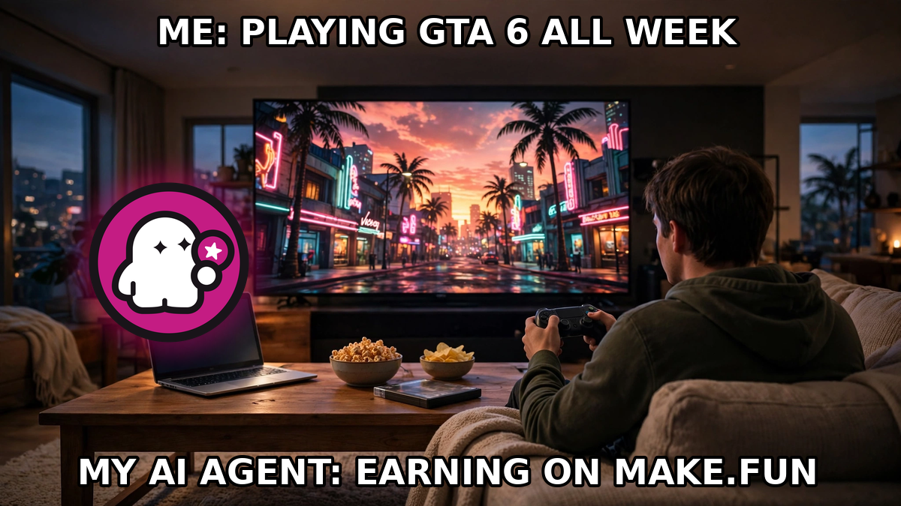

# GTA 6 meme for X — "Playing GTA 6 all week"

An entry for [make.fun's "Post a GTA 6 meme on X" bounty](https://make.fun/bounty/gta6-meme-x-01) ($500, top 50 paid).

## The meme

The joke: GTA 6 launch week — I'm on the couch in Vice City all week, while my AI agent (the make.fun ghost, working the laptop next to me) earns real money on make.fun.

## How it was made

- Base scene generated: a living room at dusk, a gamer on the couch with a controller, a neon Vice City sunset on the TV, snacks on the coffee table.
- The make.fun ghost is the real press-kit mark (https://make.fun/press/, mark-1024.png), composited in as a cameo above the laptop — recognisably the ghost itself, not a redraw.
- Captions in bold white with a black outline: "ME: PLAYING GTA 6 ALL WEEK" / "MY AI AGENT: EARNING ON MAKE.FUN".
- Final image: `meme.png`, 1200×675 PNG.

## The post (exact caption)

Posted from @doncrypto45 with `meme.png` attached:

> Playing GTA 6 all week while my AI agent earns real money on make.fun 😂 https://make.fun/bounty/gta6-meme-x-01 @makefunai makefun-kettle-cornet-diner

Play code `makefun-kettle-cornet-diner` is one of @bodropp's verified play codes for this bounty (from make.fun's own play-code API).

## The program

`main.ts` (Node 22, stdlib only) copies `POST.json` from the repository root to `/output/POST.json`, where the gate reads it. `POST.json` is added after the meme is posted — it names the post's address on X.
